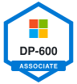
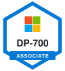
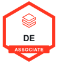
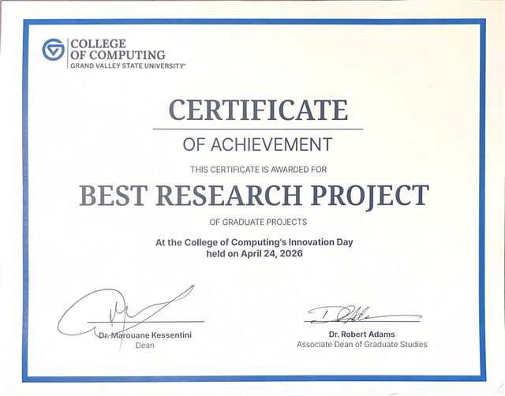
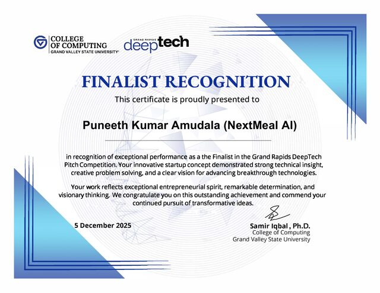
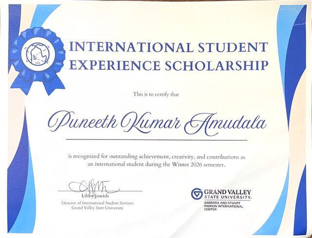
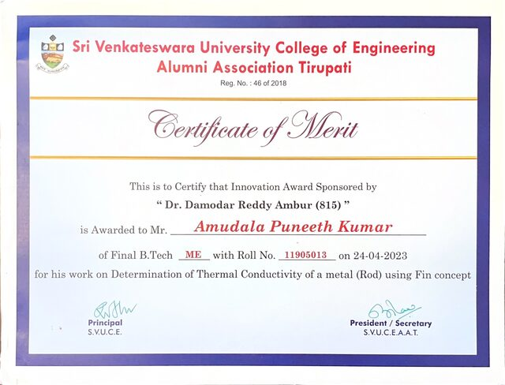

# Puneeth Kumar Amudala

### AI Data Engineer: I build the data pipelines and the AI on top of them

   

---

## What I Can Do For You

| What | How |
|---|---|
| **Build reliable data pipelines** | Batch and streaming ingestion with Airflow, PySpark, dbt and Kafka on AWS, Azure or Google Cloud |
| **Design fast, low cost lakehouses** | Models on Databricks, Microsoft Fabric, Snowflake and BigQuery that are quick to query and cheap to run |
| **Put AI on top of your data** | RAG search, LangGraph agents and MCP servers that answer questions from your own data |
| **Ship it to production** | Data quality checks, Docker, Kubernetes, Terraform and CI/CD so it keeps working after launch |

---

## About Me

AI Data Engineer with 5 years of experience across retail, insurance and customer analytics. Currently building the GCP catalog data platform at **Walmart**. [M.S. in Applied Computer Science](https://drive.google.com/file/d/1Cj59BOJ15tybcpXFGgCegIvjarrE2yZO/view) from Grand Valley State University. Based in Grand Rapids, MI.

---

## Featured Projects

### Data Engineering

| Project | What it does | Stack |
|---------|-------------|-------|
| [Flight-Data-Pipeline](https://github.com/Puneeth0106/Realtime-flight-data-engineering) | Airflow pipeline every 30 minutes moving live OpenSky data through Bronze, Silver, and Gold layers into Snowflake; keyed MERGEs prevent duplicates on reruns | Python · Airflow · Snowflake |
| [AWS-Cost-Optimizer](https://github.com/Puneeth0106/Aws-cost-optimizer) | Streamlit dashboard combining AWS billing and inventory across 7 resource categories, with a LangGraph advisor that suggests savings | Streamlit · LangGraph · Terraform · AWS |
| [NYC-Green-Taxi](https://github.com/Puneeth0106/NYC-Green-Taxi-Data-Engineering-Project) | Azure Synapse pipeline processing 2.3M trips across 19 monthly partitions into a Power BI report on demand and payments | Azure Synapse · Power BI |
| [Bing-News-Intelligence](https://github.com/Puneeth0106/Microsoft-Fabric-Projects/tree/master/Bing-News-Reporting) | PySpark notebooks curate articles and score sentiment, with Delta tables feeding a Power BI report and negative news alerts | Microsoft Fabric · PySpark · Delta · Power BI |
| [Crop-Disease-Management](https://github.com/Puneeth0106/Crop-Disease-Management-System) | Relational database backend with alerts, recommendations, and yield tracking | MySQL · Stored Procedures |

### AI Engineering

| Project | What it does | Stack |
|---------|-------------|-------|
| [Advanced-RAG-Agent](https://github.com/Puneeth0106/Advanced-RAG-Agent) | Conversational RAG agent with an 8 node LangGraph workflow: query reformulation, topic validation, relevance filtering, and bounded retries | LangGraph · RAG · Python |
| [HRMS-MCP-Server](https://github.com/Puneeth0106/HR-Management-System-MCP-server) | MCP server exposing 12 HR tools (employee records, leave, meetings, tickets, email) for Claude Desktop and other MCP clients | FastMCP · Python · Pydantic |
| [Blog-Agent](https://github.com/Puneeth0106/Blog-Generation-Agent-With-LangGraph-and-FastAPI) | LangGraph agent using GPT-4o-mini to create SEO optimized blogs in 6 languages, deployed on Vercel | LangGraph · OpenAI · FastAPI |
| [E-Commerce-Chatbot](https://github.com/Puneeth0106/Ecommerce-Chatbot) | Chatbot with semantic routing, vector FAQ retrieval, and natural language product search | Groq LLM · ChromaDB · Streamlit |

---

## Tech Stack

**Languages and Processing** 
   ![dbt](https://img.shields.io/badge/dbt-FF694B?style=for-the-badge&logo=data%3Aimage%2Fsvg%2Bxml%3Bbase64%2CPHN2ZyB4bWxucz0iaHR0cDovL3d3dy53My5vcmcvMjAwMC9zdmciIHZpZXdCb3g9IjAgMCAyNCAyNCI%2BPHBhdGggZmlsbD0iI2ZmZmZmZiIgZD0iTTE3LjkwMDQgOS4zNzYzYTguMTQ4OCA4LjE0ODggMCAwIDAtMy4wNDIxLTMuMTIwNmwxLjc3MDguODM4NWExMC4yODc0IDEwLjI4NzQgMCAwIDEgMy43NCAzLjAwMDdsMy4yMzQtNS45Mjk1YTIuODU0NiAyLjg1NDYgMCAwIDAtLjA2MTEtMi45NjA0QzIyLjc1NjYuMDM3MSAyMS4yMTEyLS4zNDA5IDE5Ljk3NTQuMzMyN2wtNS44NzQ5IDMuMjEwMWE0LjM2MTIgNC4zNjEyIDAgMCAxLTQuMTc2MSAwTDQuMTc2OS40MDhhMi44NTQ1IDIuODU0NSAwIDAgMC0yLjk1OTIuMDYzMmMtMS4xNjczLjc4NTMtMS41NDUyIDIuMzMtLjg3MjMgMy41NjU1TDMuNTUgOS45MTA2YTQuMzYxMiA0LjM2MTIgMCAwIDEgMCA0LjE3NzJsLTMuMTI3MiA1Ljc0M2EyLjg2IDIuODYgMCAwIDAgLjA4NSAyLjk5NzRjLjc5NCAxLjE0MzggMi4zMjI1IDEuNTA1NCAzLjU0NDguODM4NWw2LjA1ODEtMy4zMDQ5YTEwLjI4NzcgMTAuMjg3NyAwIDAgMS0zLjAwNTEtMy43NDU0bC0uODM3NC0xLjc3MDhhOC4xNDggOC4xNDggMCAwIDAgMy4xMjA2IDMuMDQyMWwxMC41ODMyIDUuNzc5YzEuMjIxMy42NjYgMi43NDgxLjMwNTUgMy41NDI2LS44MzYzYTIuODY5OSAyLjg2OTkgMCAwIDAgLjA3OTYtMy4wMDE4TDE3LjkwMDQgOS4zNzYzem0zLjM4MDEtNy43MzUxYy42MDIyIDAgMS4wOTA0LjQ4ODIgMS4wOTA0IDEuMDkwNHMtLjQ4ODIgMS4wOTA0LTEuMDkwNCAxLjA5MDQtMS4wOTA0LS40ODgyLTEuMDkwNC0xLjA5MDQuNDg4Mi0xLjA5MDQgMS4wOTA0LTEuMDkwNHpNMi43NDQyIDMuODIyYy0uNjAyMiAwLTEuMDkwNC0uNDg4Mi0xLjA5MDQtMS4wOTA0cy40ODgyLTEuMDkwNCAxLjA5MDQtMS4wOTA0IDEuMDkwNC40ODgyIDEuMDkwNCAxLjA5MDRTMy4zNDY0IDMuODIyIDIuNzQ0MiAzLjgyMnptMCAxOC41MzYzYy0uNjAyMiAwLTEuMDkwNC0uNDg4Mi0xLjA5MDQtMS4wOTA0IDAtLjYwMjIuNDg4Mi0xLjA5MDQgMS4wOTA0LTEuMDkwNHMxLjA5MDQuNDg4MiAxLjA5MDQgMS4wOTA0YzAgLjYwMjItLjQ4ODIgMS4wOTA0LTEuMDkwNCAxLjA5MDR6bTEwLjM1ODUtMTEuNDQ4OWMtMS4yMDA4LS4wMDM1LTIuMTc3Ljk2NzItMi4xODA1IDIuMTY3OWEyLjE3MzggMi4xNzM4IDAgMCAwIC43MDUyIDEuNjA5MWMtMS40ODcyLS4yMDkxLTIuNTIzNC0xLjU4NDMtMi4zMTQyLTMuMDcxNi4yMDkxLTEuNDg3MiAxLjU4NDMtMi41MjM0IDMuMDcxNi0yLjMxNDJhMi43MTk0IDIuNzE5NCAwIDAgMSAyLjMxNDIgMi4zMTQyIDIuMTYyMyAyLjE2MjMgMCAwIDAtMS41OTYzLS43MDU0em04LjE3NzggMTEuNDQ4OWMtLjYwMjIgMC0xLjA5MDQtLjQ4ODItMS4wOTA0LTEuMDkwNCAwLS42MDIyLjQ4ODItMS4wOTA0IDEuMDkwNC0xLjA5MDRzMS4wOTA0LjQ4ODIgMS4wOTA0IDEuMDkwNGMwIC42MDIyLS40ODgyIDEuMDkwNC0xLjA5MDQgMS4wOTA0eiIvPjwvc3ZnPg%3D%3D)

**Data Platforms** 
   ![Redshift](https://img.shields.io/badge/Redshift-8C4FFF?style=for-the-badge&logo=data%3Aimage%2Fsvg%2Bxml%3Bbase64%2CPHN2ZyB4bWxucz0iaHR0cDovL3d3dy53My5vcmcvMjAwMC9zdmciIHZpZXdCb3g9IjAgMCAyNCAyNCI%2BPHBhdGggZmlsbD0iI2ZmZmZmZiIgZD0iTTE2LjYzOSA5LjkzMmEuODIyLjgyMiAwIDAgMS0uODIyLS44Mi44MjMuODIzIDAgMCAxIDEuNjQ1IDBjMCAuNDUyLS4zNy44Mi0uODIzLjgybS0yLjA4NiA0Ljk5NGEuODIzLjgyMyAwIDAgMS0uODIyLS44MjIuODIyLjgyMiAwIDAgMSAxLjY0NSAwIC44MjIuODIyIDAgMCAxLS44MjMuODIybS01LjAwNC0uODMzYS44MjIuODIyIDAgMSAxIC4wMDItMS42NDQuODIyLjgyMiAwIDAgMS0uMDAyIDEuNjQ0bS0yLjA4MyA0LjU3OGEuODIzLjgyMyAwIDAgMS0uODIzLS44Mi44MjMuODIzIDAgMCAxIDEuNjQ1IDBjMCAuNDUyLS4zNy44Mi0uODIyLjgybTkuMTczLTExLjIzNmExLjY4IDEuNjggMCAwIDAtMS42OCAxLjY3NmMwIC41NjYuMjg1IDEuMDY2LjcxOCAxLjM3bC0uNzgyIDEuOTgyYTEuNjc0IDEuNjc0IDAgMCAwLTEuOTIzIDEuMTA0bC0xLjc1My0uMzk4YTEuNjc1IDEuNjc1IDAgMCAwLTMuMzQ4LjEwM2MwIC40MzIuMTY5LjgyMy40MzggMS4xMmwtLjc2NCAxLjc5Yy0uMDI4LS4wMDEtLjA1My0uMDA4LS4wOC0uMDA4YTEuNjggMS42OCAwIDAgMC0xLjY4IDEuNjc2IDEuNjggMS42OCAwIDAgMCAzLjM2IDBjMC0uNTkzLS4zMTItMS4xMTItLjc3OC0xLjQxbC42NzQtMS41NzljLjE2MS4wNTIuMzMuMDg4LjUwOC4wODguNjYxIDAgMS4yMjgtLjM4NiAxLjUwMi0uOTRsMS44NTYuNDJhMS42OCAxLjY4IDAgMCAwIDMuMzI3LS4zMjVjMC0uNS0uMjI0LS45NDMtLjU3NC0xLjI1bC44MjItMi4wODNjLjA1My4wMDUuMTA0LjAxNi4xNTcuMDE2YTEuNjggMS42OCAwIDAgMCAxLjY4LTEuNjc2IDEuNjggMS42OCAwIDAgMC0xLjY4LTEuNjc2TTEyIDIzLjE0NWMtNC4xNyAwLTcuMjg2LTEuMjUyLTcuMjg2LTIuMzdWNC43OUM2LjE0IDUuOTM4IDkuMTMxIDYuNTQ3IDEyIDYuNTQ3YzIuODY5IDAgNS44Ni0uNjA5IDcuMjg2LTEuNzU2djE1Ljk4M2MwIDEuMTItMy4xMTYgMi4zNy03LjI4NiAyLjM3TTEyIC44NTZjNC4yOTMgMCA3LjI4NiAxLjI3NCA3LjI4NiAyLjQxOSAwIDEuMTQzLTIuOTkzIDIuNDE4LTcuMjg2IDIuNDE4LTQuMjkzIDAtNy4yODYtMS4yNzUtNy4yODYtMi40MThDNC43MTQgMi4xMjkgNy43MDcuODU1IDEyIC44NTVtOC4xNDMgMi40MTlDMjAuMTQzIDEuMTQ3IDE1Ljk0NyAwIDEyIDAgOC4wNTIgMCAzLjg1NyAxLjE0NyAzLjg1NyAzLjI3NGwuMDAyLjAxaC0uMDAydjE3LjQ5QzMuODU3IDIyLjg3IDguMDUyIDI0IDEyIDI0YzMuOTQ3IDAgOC4xNDMtMS4xMyA4LjE0My0zLjIyNlYzLjI4NGgtLjAwMmwuMDAyLS4wMSIvPjwvc3ZnPg%3D%3D)  

**Pipelines and Cloud** 
     

**AI and Agents** 
  ![MCP](https://img.shields.io/badge/MCP-000000?style=for-the-badge&logo=data%3Aimage%2Fsvg%2Bxml%3Bbase64%2CPHN2ZyB4bWxucz0iaHR0cDovL3d3dy53My5vcmcvMjAwMC9zdmciIHZpZXdCb3g9IjAgMCAyNCAyNCI%2BPHBhdGggZmlsbD0iI2ZmZmZmZiIgZD0iTTEzLjg1IDBhNC4xNiA0LjE2IDAgMCAwLTIuOTUgMS4yMTdMMS40NTYgMTAuNjZhLjgzNS44MzUgMCAwIDAgMCAxLjE4LjgzNS44MzUgMCAwIDAgMS4xOCAwbDkuNDQyLTkuNDQyYTIuNDkgMi40OSAwIDAgMSAzLjU0MSAwIDIuNDkgMi40OSAwIDAgMSAwIDMuNTQxTDguNTkgMTIuOTdsLS4xLjFhLjgzNS44MzUgMCAwIDAgMCAxLjE4LjgzNS44MzUgMCAwIDAgMS4xOCAwbC4xLS4wOTggNy4wMy03LjAzNGEyLjQ5IDIuNDkgMCAwIDEgMy41NDIgMGwuMDQ5LjA1YTIuNDkgMi40OSAwIDAgMSAwIDMuNTRsLTguNTQgOC41NGExLjk2IDEuOTYgMCAwIDAgMCAyLjc1NWwxLjc1MyAxLjc1M2EuODM1LjgzNSAwIDAgMCAxLjE4IDAgLjgzNS44MzUgMCAwIDAgMC0xLjE4bC0xLjc1My0xLjc1M2EuMjY2LjI2NiAwIDAgMSAwLS4zOTRsOC41NC04LjU0YTQuMTg1IDQuMTg1IDAgMCAwIDAtNS45bC0uMDUtLjA1YTQuMTYgNC4xNiAwIDAgMC0yLjk1LTEuMjE4Yy0uMiAwLS40MDEuMDItLjYuMDQ4YTQuMTcgNC4xNyAwIDAgMC0xLjE3LTMuNTUyQTQuMTYgNC4xNiAwIDAgMCAxMy44NSAwbTAgMy4zMzNhLjg0Ljg0IDAgMCAwLS41OS4yNDVMNi4yNzUgMTAuNTZhNC4xODYgNC4xODYgMCAwIDAgMCA1LjkwMiA0LjE4NiA0LjE4NiAwIDAgMCA1LjkwMiAwTDE5LjE2IDkuNDhhLjgzNS44MzUgMCAwIDAgMC0xLjE4LjgzNS44MzUgMCAwIDAtMS4xOCAwbC02Ljk4NSA2Ljk4NGEyLjQ5IDIuNDkgMCAwIDEtMy41NCAwIDIuNDkgMi40OSAwIDAgMSAwLTMuNTRsNi45ODMtNi45ODVhLjgzNS44MzUgMCAwIDAgMC0xLjE4Ljg0Ljg0IDAgMCAwLS41OS0uMjQ1Ii8%2BPC9zdmc%2B) ![OpenAI](https://img.shields.io/badge/OpenAI-412991?style=for-the-badge&logo=data%3Aimage%2Fsvg%2Bxml%3Bbase64%2CPHN2ZyB4bWxucz0iaHR0cDovL3d3dy53My5vcmcvMjAwMC9zdmciIHZpZXdCb3g9IjAgMCAyNCAyNCI%2BPHBhdGggZmlsbD0iI2ZmZmZmZiIgZD0iTTIyLjI4MTkgOS44MjExYTUuOTg0NyA1Ljk4NDcgMCAwIDAtLjUxNTctNC45MTA4IDYuMDQ2MiA2LjA0NjIgMCAwIDAtNi41MDk4LTIuOUE2LjA2NTEgNi4wNjUxIDAgMCAwIDQuOTgwNyA0LjE4MThhNS45ODQ3IDUuOTg0NyAwIDAgMC0zLjk5NzcgMi45IDYuMDQ2MiA2LjA0NjIgMCAwIDAgLjc0MjcgNy4wOTY2IDUuOTggNS45OCAwIDAgMCAuNTExIDQuOTEwNyA2LjA1MSA2LjA1MSAwIDAgMCA2LjUxNDYgMi45MDAxQTUuOTg0NyA1Ljk4NDcgMCAwIDAgMTMuMjU5OSAyNGE2LjA1NTcgNi4wNTU3IDAgMCAwIDUuNzcxOC00LjIwNTggNS45ODk0IDUuOTg5NCAwIDAgMCAzLjk5NzctMi45MDAxIDYuMDU1NyA2LjA1NTcgMCAwIDAtLjc0NzUtNy4wNzI5em0tOS4wMjIgMTIuNjA4MWE0LjQ3NTUgNC40NzU1IDAgMCAxLTIuODc2NC0xLjA0MDhsLjE0MTktLjA4MDQgNC43NzgzLTIuNzU4MmEuNzk0OC43OTQ4IDAgMCAwIC4zOTI3LS42ODEzdi02LjczNjlsMi4wMiAxLjE2ODZhLjA3MS4wNzEgMCAwIDEgLjAzOC4wNTJ2NS41ODI2YTQuNTA0IDQuNTA0IDAgMCAxLTQuNDk0NSA0LjQ5NDR6bS05LjY2MDctNC4xMjU0YTQuNDcwOCA0LjQ3MDggMCAwIDEtLjUzNDYtMy4wMTM3bC4xNDIuMDg1MiA0Ljc4MyAyLjc1ODJhLjc3MTIuNzcxMiAwIDAgMCAuNzgwNiAwbDUuODQyOC0zLjM2ODV2Mi4zMzI0YS4wODA0LjA4MDQgMCAwIDEtLjAzMzIuMDYxNUw5Ljc0IDE5Ljk1MDJhNC40OTkyIDQuNDk5MiAwIDAgMS02LjE0MDgtMS42NDY0ek0yLjM0MDggNy44OTU2YTQuNDg1IDQuNDg1IDAgMCAxIDIuMzY1NS0xLjk3MjhWMTEuNmEuNzY2NC43NjY0IDAgMCAwIC4zODc5LjY3NjVsNS44MTQ0IDMuMzU0My0yLjAyMDEgMS4xNjg1YS4wNzU3LjA3NTcgMCAwIDEtLjA3MSAwbC00LjgzMDMtMi43ODY1QTQuNTA0IDQuNTA0IDAgMCAxIDIuMzQwOCA3Ljg3MnptMTYuNTk2MyAzLjg1NThMMTMuMTAzOCA4LjM2NCAxNS4xMTkyIDcuMmEuMDc1Ny4wNzU3IDAgMCAxIC4wNzEgMGw0LjgzMDMgMi43OTEzYTQuNDk0NCA0LjQ5NDQgMCAwIDEtLjY3NjUgOC4xMDQydi01LjY3NzJhLjc5Ljc5IDAgMCAwLS40MDctLjY2N3ptMi4wMTA3LTMuMDIzMWwtLjE0Mi0uMDg1Mi00Ljc3MzUtMi43ODE4YS43NzU5Ljc3NTkgMCAwIDAtLjc4NTQgMEw5LjQwOSA5LjIyOTdWNi44OTc0YS4wNjYyLjA2NjIgMCAwIDEgLjAyODQtLjA2MTVsNC44MzAzLTIuNzg2NmE0LjQ5OTIgNC40OTkyIDAgMCAxIDYuNjgwMiA0LjY2ek04LjMwNjUgMTIuODYzbC0yLjAyLTEuMTYzOGEuMDgwNC4wODA0IDAgMCAxLS4wMzgtLjA1NjdWNi4wNzQyYTQuNDk5MiA0LjQ5OTIgMCAwIDEgNy4zNzU3LTMuNDUzN2wtLjE0Mi4wODA1TDguNzA0IDUuNDU5YS43OTQ4Ljc5NDggMCAwIDAtLjM5MjcuNjgxM3ptMS4wOTc2LTIuMzY1NGwyLjYwMi0xLjQ5OTggMi42MDY5IDEuNDk5OHYyLjk5OTRsLTIuNTk3NCAxLjQ5OTctMi42MDY3LTEuNDk5N1oiLz48L3N2Zz4%3D)    

**Quality and Delivery** 
     

---

## Certifications

| Badge | Certification | Skills |
|:---:|---|---|
|  | **[SQL AI Developer Associate (DP-800)](https://learn.microsoft.com/en-us/credentials/certifications/developing-ai-enabled-database-solutions/)** Sep 2026 | T-SQL and database design, vector, full-text and hybrid search, embeddings and RAG inside SQL, row-level security and encryption, CI/CD with SQL Database Projects |
|  | **[Azure AI Apps and Agents Developer Associate (AI-103)](https://learn.microsoft.com/en-us/users/puneethkumaramudala-2163/credentials/c4cb907f879307da)** Aug 2026 | Generative AI apps and agents in Microsoft Foundry, retrieval and grounding pipelines, document extraction, vision, speech and text analysis, responsible AI and monitoring |
|  | **[Fabric Analytics Engineer Associate (DP-600)](https://learn.microsoft.com/en-us/users/PuneethkumarAmudala-2163/credentials/68C46B35129AB4A0)** Jan 2026 | Lakehouse and warehouse design, data preparation with SQL and PySpark, semantic models and DAX, security and deployment of analytics solutions |
|  | **[Fabric Data Engineer Associate (DP-700)](https://learn.microsoft.com/en-us/users/puneethkumaramudala-2163/credentials/59683c57e332ede2)** Oct 2025 | Batch and streaming ingestion, transformation with PySpark and SQL, orchestration with pipelines, monitoring and performance tuning |
|  | **[Databricks Data Engineer Associate](https://credentials.databricks.com/60fbaceb-08e5-4971-a616-c3d2eacae0cd)** May 2025 | Lakehouse and Delta Lake, ELT with Spark SQL and PySpark, incremental loads with Auto Loader, production jobs and workflows, Unity Catalog governance |

---

## Publications

- **Co-author**, *Soil Moisture Prediction and Benchmark Reliability: A Review with Multi-Site SMAP–ISMN Analysis*. International Journal on Advances in Intelligent Systems, vol. 19, 2026. [Read the paper](https://www.thinkmind.org/library/IntSys/IntSys_v19_n12_2026/intsys_v19_n12_2026_5.html)

## Honors and Awards

<table>
  <tr>
    <td align="center" width="50%">
       
      <b>Best Research Project</b> 
      GVSU College of Computing Innovation Day · Apr 2026
    </td>
    <td align="center" width="50%">
       
      <b>Finalist, Grand Rapids DeepTech Pitch Competition</b> 
      Final project: NextMeal AI · Dec 2025
    </td>
  </tr>
  <tr>
    <td align="center" width="50%">
       
      <b>International Student Experience Scholarship</b> 
      Grand Valley State University · Winter 2026
    </td>
    <td align="center" width="50%">
       
      <b>Innovation Award (Certificate of Merit)</b> 
      SVU College of Engineering, Tirupati · Apr 2023
    </td>
  </tr>
</table>

- **[Graduation Regalia Scholarship](https://drive.google.com/file/d/176BPKvw7n33L6eRG1EyKOleO2BQMWKYP/view)**, GVSU, for outstanding academic achievement (Winter 2026)
- **[Pratibha Award](https://drive.google.com/file/d/17itdyoVoNRIk6lFLp0V_4RdDsYfZoERi/view)**, Government of Andhra Pradesh, for excellence in the Secondary School Certificate exam (2017)

All certificates: [Google Drive folder](https://drive.google.com/drive/folders/1qdZ8TwPwxwTWSZIaXLJM4hDddFS-dZee)

---

## GitHub Stats

  &nbsp; 
  

**Have a data or AI problem to solve?** Reach me at [puneethkumaramudala@gmail.com](mailto:puneethkumaramudala@gmail.com)

